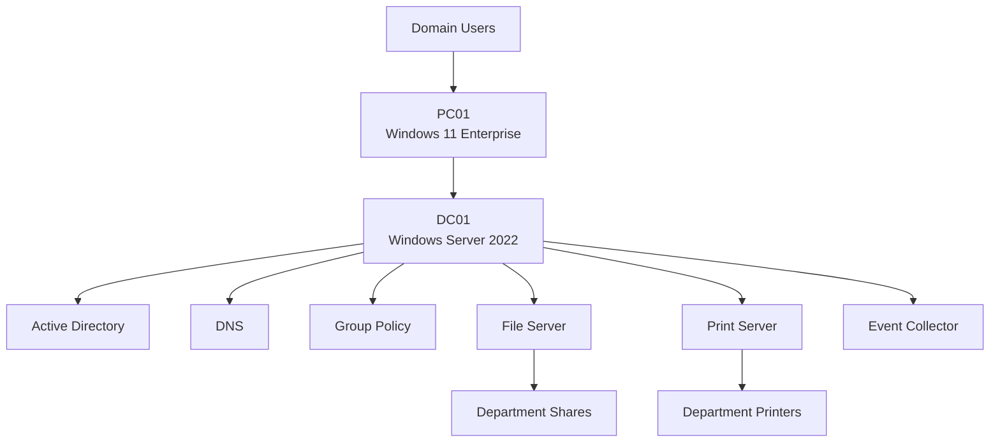

# User Authentication & Resource Assignment Flow

```text
User Sign In
      │
      ▼
PC01 Windows 11
      │
      ▼
DNS Query
      │
      ▼
DC01 DNS Server
      │
      ▼
Active Directory Authentication
      │
      ▼
Security Group Membership Evaluation
      │
      ▼
Group Policy Processing
      │
      ├── Drive Mapping
      ├── Printer Deployment
      ├── Wallpaper Assignment
      ├── Software Deployment
      └── Security Policies
      │
      ▼
User Receives Authorized Resources
```

# RBAC (Role-Based Access Control) Model

```text
Finance User
      │
      ▼
Finance-Team
      │
      ├── FINANCE_Drive
      ├── FINANCE-PRINTER
      └── Finance Documents

Finance-Team-Payroll
      │
      └── Payroll Folder

Only Approved Payroll Staff
      │
      ▼
Finance-Team-Payroll
      │
      ▼
Payroll Access Granted

All Other Finance Users
      │
      ▼
Payroll Access Denied
```

# Security Monitoring Architecture

```text
PC01
│
├── Successful Logons (4624)
├── Failed Logons (4625)
├── Account Lockouts (4740)
├── Account Management Events
│
▼
Windows Event Forwarding
│
▼
DC01 Event Collector
│
├── Security Monitoring
├── Audit Review
├── Incident Investigation
└── Compliance Logging
```


# SoloTech Lab Architecture




# Technical Architecture Diagram

```mermaid
graph TD

    USER1[IT User]
    USER2[HR User]
    USER3[Finance User]
    USER4[Sales User]
    USER5[Customer Service User]

    USER1 --> PC01[PC01 Windows 11 Enterprise]
    USER2 --> PC01
    USER3 --> PC01
    USER4 --> PC01
    USER5 --> PC01

    PC01 --> DC01[DC01 Windows Server 2022]

    DC01 --> ADDS[Active Directory Domain Services]
    DC01 --> DNS[DNS Server]
    DC01 --> GPO[Group Policy Management]
    DC01 --> FILE[File Server]
    DC01 --> PRINT[Print Server]
    DC01 --> SOFTWARE[Software Repository]
    DC01 --> EVENTS[Windows Event Collector]

    FILE --> ITD[IT_Data]
    FILE --> HRD[HR_Data]
    FILE --> FIND[FINANCE_Data]
    FILE --> SALESD[SALES_Data]
    FILE --> CSD[CS_Data]
    FILE --> PAYROLL[Payroll Folder]

    PRINT --> ITP[IT-PRINTER]
    PRINT --> HRP[HR-PRINTER]
    PRINT --> FINP[FINANCE-PRINTER]
    PRINT --> SALP[SALES-PRINTER]
    PRINT --> CSP[CUST-SERV-PRINTER]

    ADDS --> ITTEAM[IT-Team]
    ADDS --> HRTEAM[HR-Team]
    ADDS --> FINTEAM[Finance-Team]
    ADDS --> SALTEAM[Sales-Team]
    ADDS --> CSTEAM[CustomerService-Team]
    ADDS --> PAYGROUP[Finance-Team-Payroll]

    GPO --> DRIVE[Drive Mapping GPO]
    GPO --> WALL[HR Wallpaper GPO]
    GPO --> RESTRICT[Customer Service Restrictions]
    GPO --> PRINTERGPO[Printer Deployment GPO]
    GPO --> SOFTGPO[Software Deployment GPO]
    GPO --> AUDIT[Audit & Event Logging Policy]

    EVENTS --> LOGON[Logon Events]
    EVENTS --> LOCKOUT[Account Lockouts]
    EVENTS --> MANAGEMENT[Account Management Events]

    PAYGROUP --> PAYROLL

```


